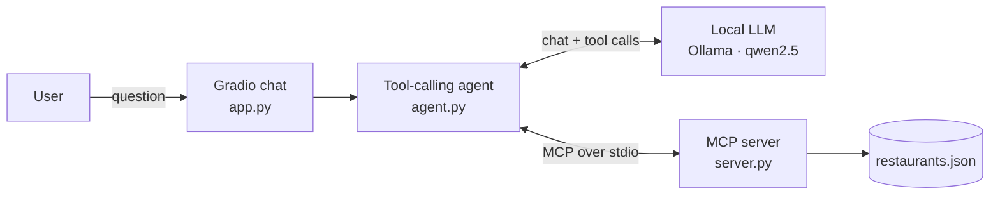

# 🍽️ California Restaurant Concierge

[](https://github.com/abellucido/restaurant-concierge-mcp/actions/workflows/tests.yml)

A chatbot that recommends California restaurants by cuisine, city, vibe or budget. An LLM agent answers questions by calling tools on a **Model Context Protocol (MCP) server**, so every recommendation comes from real data rather than the model's imagination. It runs **entirely on your own machine** with a local model through [Ollama](https://ollama.com): no API keys, no cost.

<!-- Add a screenshot of the running app: docs/screenshot.png -->

## How it works



1. The agent starts the MCP server and discovers its tools at runtime.
2. The LLM decides which tools to call and with which arguments.
3. The agent runs those calls through MCP and feeds the results back, looping until the LLM can answer.
4. The chat shows which tools were used for each answer.

### MCP server

| Type | Name | Purpose |
|---|---|---|
| Tool | `search_restaurants` | Filter by any mix of cuisine, city or neighborhood, vibe, max price and min rating; results sorted by rating |
| Tool | `get_restaurant` | Full details for one place; tolerates partial and misspelled names |
| Tool | `get_reviews` | Customer reviews plus their average score |
| Resource | `restaurants://overview` | Cities, cuisines and vibes the dataset covers |

### Dataset

`data/restaurants.json` holds fictional restaurants generated by [`scripts/generate_dataset.py`](scripts/generate_dataset.py). The script prompts a local model from seeds (city, neighborhood, cuisine, vibe), constrains its output to a JSON schema, and validates every record with Pydantic before saving. Regenerate or extend it by editing the seed list and running:

```bash
python scripts/generate_dataset.py
```

## Getting started

**You need:** Python 3.10+ and [Ollama](https://ollama.com/download). A GPU with ~6 GB of memory makes responses fast, but a CPU also works.

```bash
git clone https://github.com/abellucido/restaurant-concierge-mcp.git
cd restaurant-concierge-mcp

ollama pull qwen2.5:7b

python -m venv .venv && source .venv/bin/activate   # or use conda
pip install -r requirements.txt

python src/concierge/app.py
```

Open http://127.0.0.1:7860 and try one of the example questions.

Optional settings (model, Ollama host, public share link) are listed in [`.env.example`](.env.example); copy it to `.env` to change them. With less GPU memory, try `OLLAMA_MODEL=qwen2.5:3b`.

## Tests

The MCP tools are tested in-memory against a small fixture dataset, with no LLM needed. GitHub Actions runs them on every push.

```bash
pytest -v tests
```

## Project structure

```
├── data/restaurants.json        Generated restaurant dataset
├── scripts/generate_dataset.py  Dataset generator (Ollama + JSON schema + Pydantic)
├── src/concierge/
│   ├── server.py                MCP server: tools and resource (FastMCP)
│   ├── agent.py                 MCP client + tool-calling loop (LangChain + Ollama)
│   └── app.py                   Chat UI (Gradio)
└── tests/                       Server tests and fixture data
```

## Tech stack

Python · Model Context Protocol (FastMCP) · LangChain · Ollama (Qwen 2.5) · Gradio · Pydantic · pytest · GitHub Actions

## Background

Inspired by what I learned in the [IBM RAG and Agentic AI Professional Certificate](https://www.coursera.org/professional-certificates/ibm-rag-and-agentic-ai) on Coursera. This repository is an independent implementation with its own code and dataset; it contains no course materials.

## License

[MIT](LICENSE)
